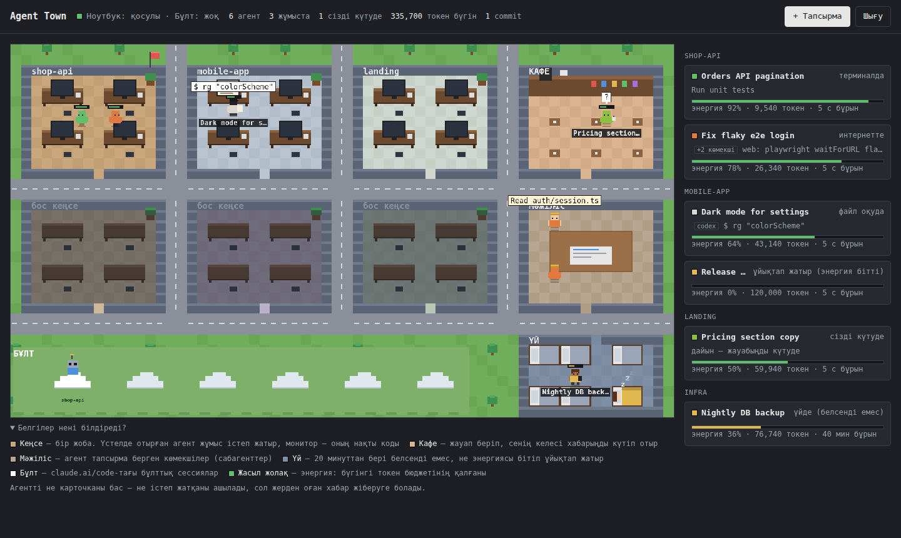
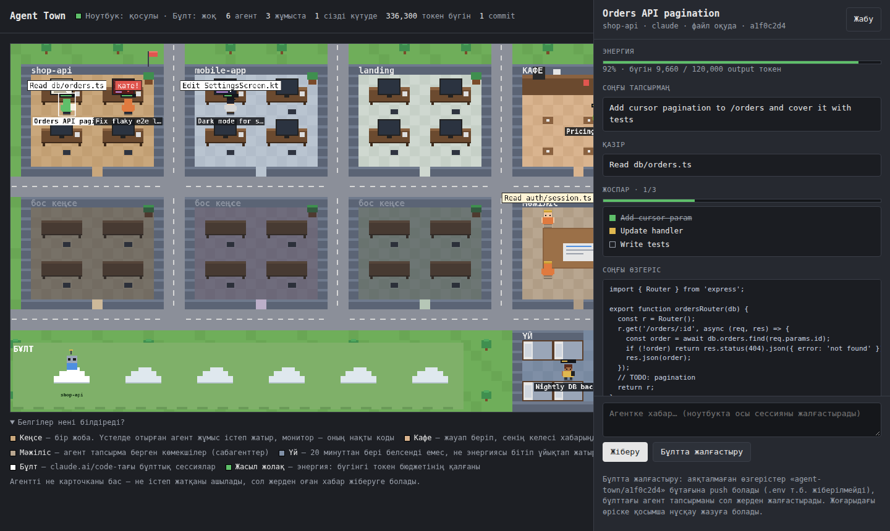
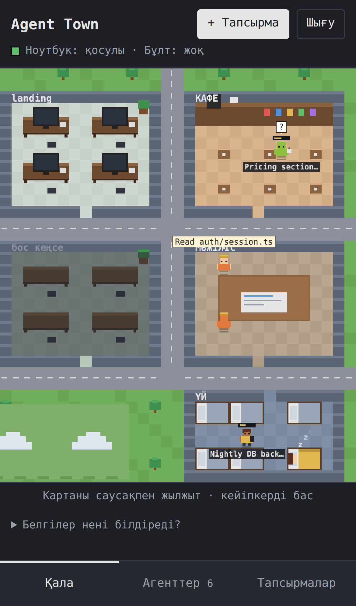

# Agent Town

Agent Town turns your AI coding agents into a small pixel town you can watch
and steer from any browser, including your phone.

Every Claude Code or Codex session on your laptop becomes a character. Each
project gets an office. A character sits at a desk while its agent works, and
the monitor shows a minimap of the code it is editing. It waits in the café
when the agent is waiting for you, and goes home to sleep when its daily
energy (token budget) runs out. Click a character to see what it is doing and
to send it a message.



The interface is in Kazakh. Translations are welcome.

## What you see

| Place | Meaning |
|---|---|
| Office | One project (git repo). Agents at desks are working; the monitor shows their real code, terminal or page |
| Café | The agent answered and is waiting for your next message |
| Meeting room | Subagents the main agent delegated to, with what each one is doing |
| Home | Inactive for 20+ minutes, or asleep because the energy ran out |
| Cloud | Claude Code cloud sessions on claude.ai/code |

Speech bubbles show the real current action: `Edit orders.ts`, `Run unit
tests`, `grep "login"`, a web search. Failed tests and tool errors turn the
bubble and the screen red, and a flag goes up on the office after a `git
commit` or `git push`.

The agent panel shows your last prompt, the agent's todo plan, its latest
code change, terminal output, changed files and a timeline of recent actions.

<p align="center"> </p>

## Remote control

From the site you can:

- **Message an agent.** Runs `claude -p --resume <session>` (or `codex exec
  resume`) in that project on your laptop.
- **Start a new task** in any project folder with Claude, Codex or a Claude
  cloud session.
- **Stop** a task started from the site.
- **Continue in the cloud.** Pushes the session's unfinished work to an
  `agent-town/<session>` branch and opens a Claude Code cloud session on it,
  with a handoff note: your last prompt, the todo plan, changed files and the
  last 20 actions. Your current branch, index and working tree are not
  touched. `.env`, keys, `*.pem`, `*.db` and files over 5 MB are left out.

When the laptop is off, the town shows the last known state and the server
can still open and message cloud sessions on its own.

## How it works

```
 laptop                                server                         browser
┌───────────────────────┐   HTTPS   ┌───────────────────────────┐   HTTPS   ┌──────────┐
│ bridge                │──state───▶│ relay (Node, Docker)      │──SSE────▶│ town UI  │
│  reads ~/.claude and  │◀─commands─│  password login, audit log│◀─commands│ (canvas) │
│  ~/.codex transcripts │  long-poll│                           │          └──────────┘
│  runs claude / codex  │           │ cloud worker (systemd)    │
└───────────────────────┘           │  claude --cloud when the  │
                                    │  laptop is offline        │
                                    └───────────────────────────┘
```

- **bridge** (`bridge/bridge.js`) runs on your laptop. It reads Claude Code
  transcripts (`~/.claude/projects/*/*.jsonl`, including subagents) and Codex
  rollouts (`~/.codex/sessions`) in place, without modifying them. It sends
  the town state to the relay and executes the commands the relay hands back.
  The laptop only makes outgoing requests, so no ports are opened.
- **relay** (`relay/relay.js`) serves the UI, keeps the latest state, and
  queues commands. It only listens on localhost behind nginx.
- **cloud worker** (`worker/cloud_worker.py`) runs on the server and handles
  cloud commands while the laptop is offline.
- `claude --cloud` needs an interactive terminal, so `cloud_launch.py` runs
  it inside a pseudo-terminal and captures the session URL.

There are no dependencies: Node 22+ for the bridge and relay, and the Python 3
standard library for the cloud helpers.

## Setup

### 1. Server (relay)

You need a Linux server with Docker, nginx and a domain pointing to it.

```bash
cp relay/.env.example relay/.env.prod      # set TOWN_PASSWORD, BRIDGE_TOKEN, SESSION_SECRET
TOWN_SERVER=root@your-server ./deploy.sh   # copies files, starts the container and the cloud worker
```

Then add the nginx site from `deploy/nginx.conf.example` (it disables
buffering for the SSE stream) and get a certificate:

```bash
certbot --nginx -d town.example.com --redirect
```

### 2. Laptop (bridge)

```bash
cp bridge/.env.example bridge/.env         # RELAY_URL and the same BRIDGE_TOKEN
node bridge/bridge.js --dump               # check what it sees, without sending anything
cp deploy/agent-town-bridge.service ~/.config/systemd/user/
systemctl --user daemon-reload && systemctl --user enable --now agent-town-bridge
```

`ALLOWED_ROOT` (default: your home folder) limits where commands can run.
`DAILY_BUDGET` sets the daily output-token budget that is drawn as energy.

### 3. Cloud sessions without the laptop (optional)

Install Claude Code on the server and sign in once with a claude.ai account:

```bash
curl -fsSL https://claude.ai/install.sh | bash
claude auth login --claudeai
```

Run `./deploy.sh` again so the cloud worker is installed. The server needs
no GitHub access: cloud sessions clone the repo from GitHub themselves. The
Claude GitHub app must be installed on your repos.

### Try it without agents

```bash
cd relay && TOWN_PASSWORD=demo BRIDGE_TOKEN=demo node relay.js
cd bridge && BRIDGE_TOKEN=demo node demo.js
# open http://127.0.0.1:3020 (password: demo), add ?hour=14 for daylight
```

## Security

**Read this before deploying.** Tasks started from the site run with
`--permission-mode bypassPermissions` on your laptop. Anyone who has the site
password can run arbitrary commands there.

- Use a long random `TOWN_PASSWORD`. Logins are rate-limited (8 per 10 minutes
  per IP), and the session cookie is `HttpOnly`, `Secure`, `SameSite=Strict`
  and HMAC-signed.
- The bridge and the cloud worker authenticate with a separate `BRIDGE_TOKEN`.
- Every login and command is written to `data/audit.jsonl` on the server.
- Before anything leaves your laptop, values that look like secrets are
  masked: `*_TOKEN=`, `*_KEY=`, `PASSWORD=`, Bearer tokens, `sk-…`, `ghp_…`,
  bot tokens and long random strings.
- Prompts, file names, commands and code snippets are still sent to your
  server, which keeps the latest state on disk. Host the relay yourself.
- "Continue in the cloud" pushes work-in-progress to GitHub. On a public
  repository that branch is public too.

## Limitations

- Only Claude Code and Codex are read. Claude Code is the most detailed
  (subagents, todos, errors).
- The progress of a cloud session is only visible on claude.ai/code; the
  town shows its link and lets you message it.
- Headless `claude --cloud "task"` is not officially documented, so the
  pseudo-terminal workaround may need updating when the CLI changes.
- Six offices: the five most active projects get their own, the rest share
  "other projects".

## Related

[kopir](https://github.com/raissov01/kopir) gives Claude Code, Codex and
other agents one shared memory.

## License

MIT
